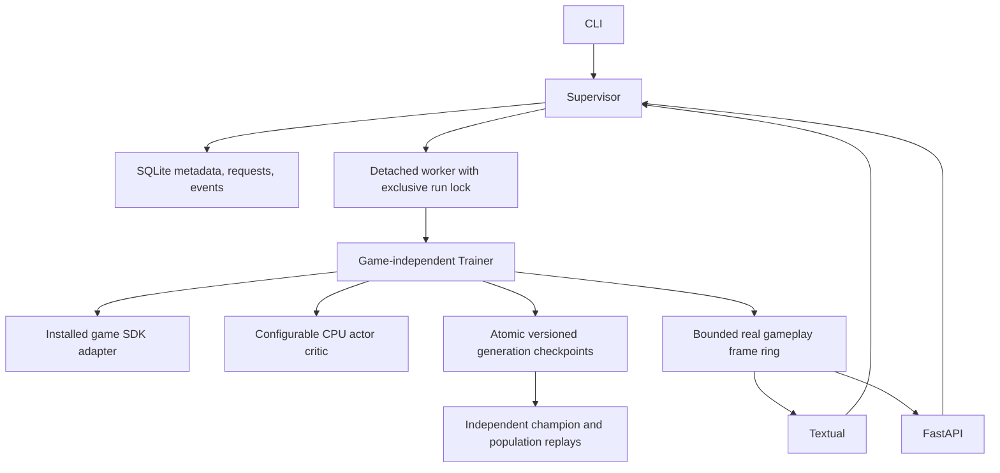

# Architecture, security and troubleshooting

Flat legacy modules remain import-compatible. SDK, agents, core, supervisor,
telemetry, storage and API packages provide explicit boundaries. The learning
engine imports no Textual/FastAPI modules. SQLite schema 1 is migrated in a
transaction; unknown future schemas are rejected. Metadata and unique-generation
metrics are stored in SQLite, while checkpoints and compatible CSV exports live
in run directories. Checkpoint history is the recovery source of truth.

## Security model

This is a trusted local-operator platform. The runs root, configuration and
installed plugins must be writable only by trusted users. Entry-point discovery
imports explicitly installed Python code, with the full operator's privileges.
Do not install unreviewed games or treat this as a multi-tenant execution sandbox.
There is no game upload, arbitrary shell command, or arbitrary path API.

Remote API bindings require a Bearer token. Prefer loopback plus SSH forwarding,
or put a TLS reverse proxy in front of remote bindings. Never log tokens. The
systemd EnvironmentFile should be mode 600. HTTP schemas/docs are public; state
and control endpoints are authenticated when a token is configured.

Checkpoint readers use restricted torch loading, never unrestricted pickle
fallback. SHA256 detects accidental changes but is not a signature. Use trusted
files; tensor artifacts can still consume memory. Explicit migration creates
backups. API ids are bounded slugs, paths stay under the configured root and
symlinked experiment directories are rejected. No PID-only signaling is used.

## Troubleshooting

- **Missing modules:** run `.venv/bin/python -m pip install -e '.[tui,api]'` and use
  the same interpreter for worker/client. `doctor` reports installed extras.
- **Worker STARTING/FAILED:** inspect Workers or `workers status ID --root runs`,
  then read that run's training.log. Invalid plugin configuration and checkpoint
  mismatches are surfaced as errors, not resets.
- **Duplicate-worker conflict:** use the existing worker. A leftover lock file
  alone is harmless; a held kernel flock means a process still owns the run.
- **Stale worker:** boot/process identity or heartbeat is invalid. Investigate,
  then `workers recover ID --root runs`. A live hung worker's lock still prevents
  duplication. Requests cannot interrupt a plugin blocked inside Python/native code.
- **Corrupt checkpoint:** primary load falls back to `.bak`, reconciles committed
  metrics and preserves pre-recovery CSV. If both fail, restore an external backup.
- **No live frames:** select Live Training, check worker health and wait for an
  evaluation. Frames are sampled and bounded, so sequence gaps are normal.
- **Remote 401 / WebSocket 4401:** use the matching Authorization header.
  Reconnect streams with `?since=last_sequence`.
- **Changed policy/game:** resume rejects changed config, plugin version or model
  shape. Duplicate the configuration into a new run for a different experiment.
- **GPU kernels unsupported:** use CPU torch; GTX 1070 support depends on build
  and driver. Availability alone does not establish working CUDA kernels.
- **Small terminal:** use fewer replay panels/focus mode, scroll forms or enlarge
  the terminal. Real terminal/SSH behavior is an operator acceptance gate.

## Current scaling boundaries

CPU-only numeric flattened Box observations and discrete actions are supported.
Images, recurrent policies, continuous control, multi-host scheduling and GPU
training are outside v1 scope. Checkpoint history/lineage and CSV reconstruction
currently grow with run length; benchmark long runs before large deployments.
Telemetry is intentionally lossy and not an archival video stream. Host reboot
recovery is explicit, never automatic third-party execution.
