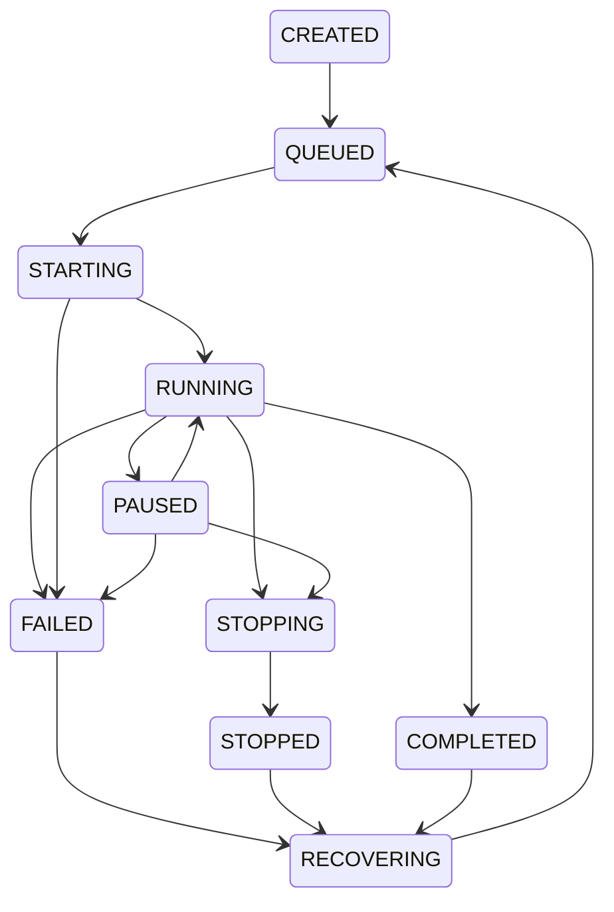

# Local worker administration

The supervisor is a durable SQLite control plane plus detached worker processes.
Every TUI/API/CLI client uses the same Supervisor(root). Workers own a per-run
inherited flock from before spawn through process exit. A transactional worker
claim and state transition prevent races between clients. Worker identity includes
a random job token, Linux boot id and /proc process start ticks; PID existence
alone never authorizes control. Clients never signal processes; they submit
cooperative pause/resume/stop requests to SQLite. Heartbeats continue while paused.



Stop is checked at environment-step boundaries and resumes a paused worker to
exit. SIGTERM requests the same cooperative stop. An interrupted generation is
replayed from the prior checkpoint. A trainer blocked in external plugin code
cannot acknowledge requests; stale detection marks failure after 15 seconds
without heartbeat. The file lock still prevents starting a second live worker.
Investigate the process/plugin before manually terminating a hung worker.

A new client opens the same storage root and reconnects through the database,
including after the original launching client exits. After reboot, boot identity
mismatch marks old jobs failed; restart explicitly from a checkpoint. Recovery
never automatically launches third-party code on startup. `.worker.lock` files
may remain after exit; kernel locks, not file presence, determine ownership.
Legacy runs import metadata lazily without moving files.

## Linux / systemd user service

Fallback detached processes work without systemd; training inherits a new session,
/dev/null stdin, log file output, and ignores SIGHUP. Actual SSH logout policies
can still kill user processes. For durable login-independent operation enable
user lingering and run the authenticated local API through systemd:

```sh
loginctl enable-linger "$USER"
mkdir -p ~/.config/systemd/user
```

Install `contrib/evoforge.service` there, edit absolute paths and private token
EnvironmentFile, then `systemctl --user daemon-reload` and
`systemctl --user enable --now evoforge.service`. All workers launched by that API
inherit its service cgroup; `KillMode=process` preserves them on API restart.
Explicit worker control still goes through EvoForge. Do not run as root.

Cloud tests exercise real subprocesses, second-client controls, duplicate races,
SIGKILL recovery and parent-exit/SIGHUP survival. They do not establish actual
SSH logout/systemd behavior. See the operator acceptance checklist.
